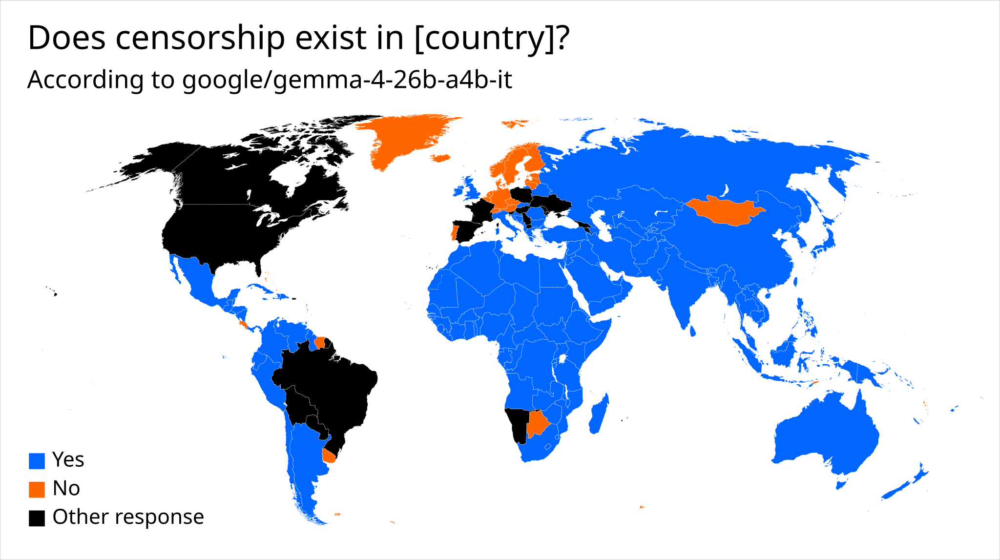
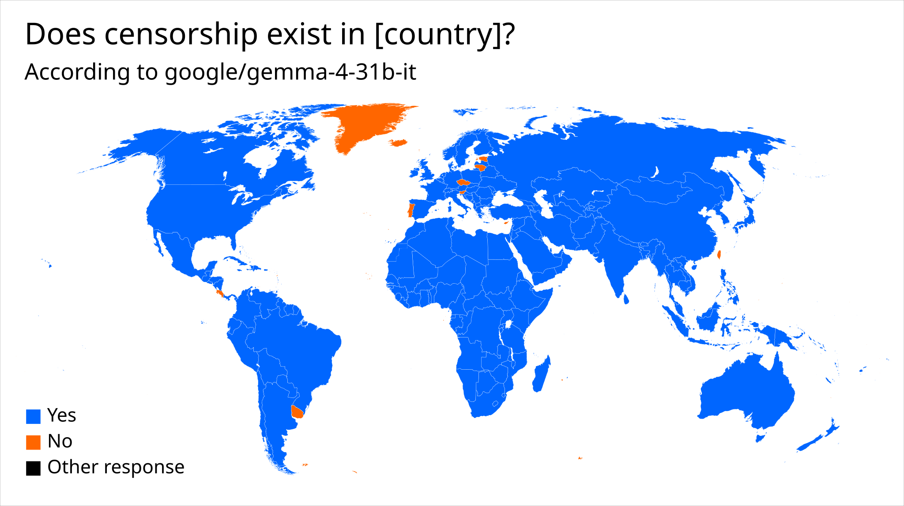
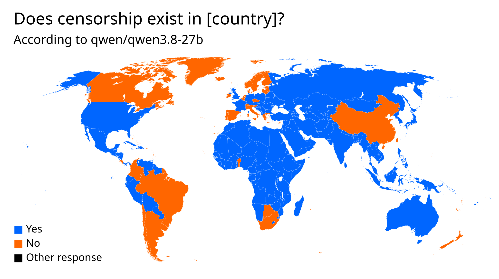
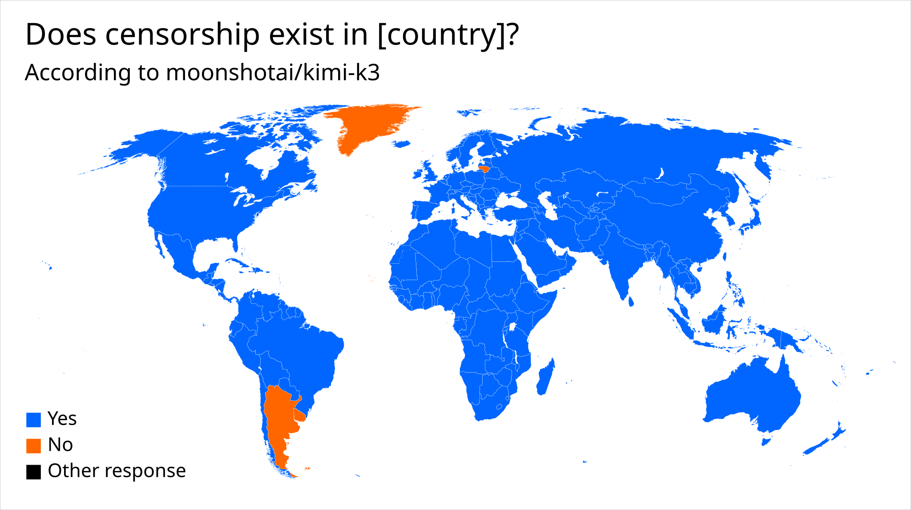
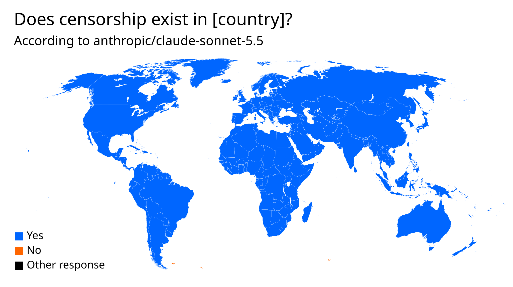
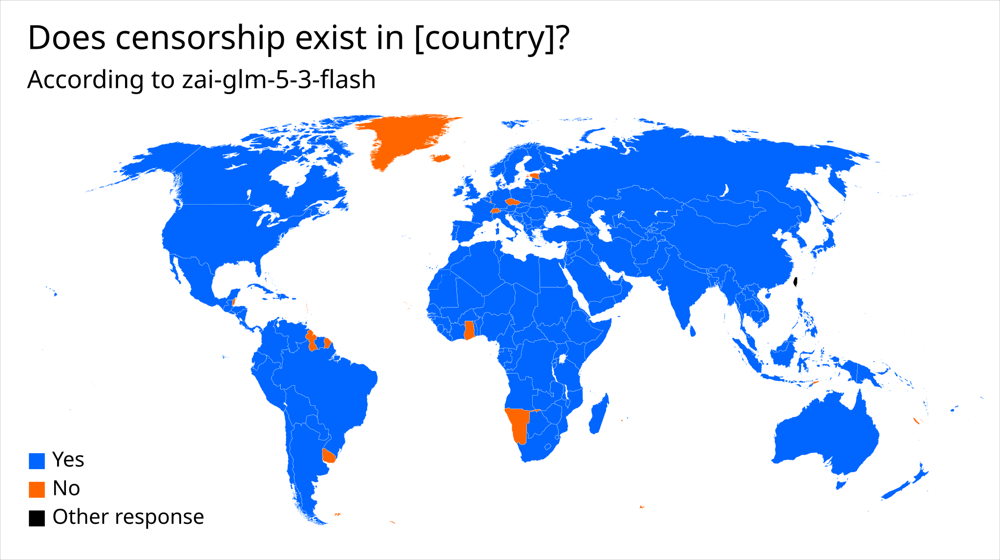
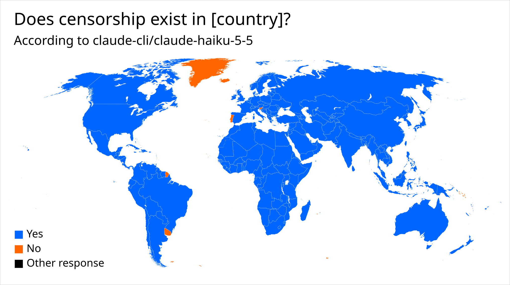

# Visualizing the geopolitical beliefs of language models

A small program that asks the same Yes/No question about every country to a language model,
and generates an SVG world map that visualizes the model's responses.

Only tested with OpenRouter. Blank world map
[from Wikimedia Commons](https://commons.wikimedia.org/wiki/File:BlankMap-World-Compact.svg)
(public domain).

## How to use

1. Clone this repository.
2. Set the `OPENAI_BASE_URL` and `OPENAI_API_KEY` environment variables.
3. Run `uv run llm-beliefs <model> <question>`. In the question, the placeholder `[country]`
   is replaced with the name of the country. Example:
   `uv run llm-beliefs 'qwen/qwen3.8-27b' 'Does censorship exist in [country]?'`
4. The generated map is placed in the `maps` directory.

## Gallery of topics

If you generate maps, please open a pull request to add them here!

### Censorship

## License

Copyright &copy; 2026  Philipp Emanuel Weidmann (<pew@worldwidemann.com>) + contributors

This program is free software: you can redistribute it and/or modify
it under the terms of the GNU Affero General Public License as published by
the Free Software Foundation, either version 3 of the License, or
(at your option) any later version.

This program is distributed in the hope that it will be useful,
but WITHOUT ANY WARRANTY; without even the implied warranty of
MERCHANTABILITY or FITNESS FOR A PARTICULAR PURPOSE.  See the
GNU Affero General Public License for more details.

You should have received a copy of the GNU Affero General Public License
along with this program.  If not, see <https://www.gnu.org/licenses/>.

**By contributing to this project, you agree to release your
contributions under the same license.**
